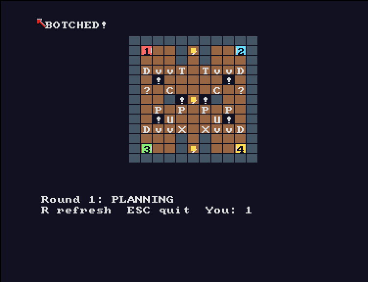

# Amiga A1 review

**Current status:** A1a (`53feea99`) and A1b (`6171f12b`) are accepted.
[A1c reliability and multiplayer acceptance](a1c-review.md) is ready for review,
with explicit broker-level limits.
The following is the retained A1a baseline; its remaining-work statements describe
that accepted slice, not the current client.

# A1a — A500 connection and board display

**A1a is implemented and verified on an emulated stock 68000 A500, Kickstart
1.3, 512 KB Chip + 512 KB expansion RAM. A1 is not yet complete.** This is the
first independently testable vertical slice authorized by the A1 request. It
joins a supplied match through existing FujiNet-NIO, retrieves its immutable map
and authoritative snapshot, and displays terrain, crates and numbered robots.
Keyboard R refreshes the snapshot; Escape closes the connection and display.

The accepted Atari spike `52fbe662` is unchanged and paused. This work does not
modify the rules, wire format, server, Linux clients, NIO firmware or NIO library.
There is no CREATE_MATCH, match browser, lobby, bot logic or local simulation in
the Amiga executable. The acceptance harness creates matches as the **server
operator** before launching the client.

## Delivered and remaining A1 scope

| A1 requirement | Status |
|---|---|
| Buildable stock 68000 / KS1.3 executable | Delivered, `build/amiga/botched-amiga` |
| Configurable server URL and known match ID | Delivered as Shell arguments |
| Binary connection through NIO | Delivered using existing broker and B4 transport |
| JOIN, paginated map and snapshot | Delivered; validated before publication |
| Render board and robots | Delivered, 320x200 eight-colour OCS screen |
| Three-order keyboard/controller selection and submission | **Remaining A1 work**; R/Escape are the only current controls |
| Receive events and perform simple replay | **Remaining A1 work**; this slice uses explicit snapshot refresh |
| Complete multiplayer gameplay/deadline/recovery acceptance | **Remaining A1 work** |

A1b should connect three-order input to SUBMIT and add bounded event replay to the
portable presentation model. A1c should verify complete mixed-client matches,
deadlines, stalled/disconnected NIO and reconciliation, while remeasuring this
same 1 MB configuration. These are review boundaries inside A1, not new Amiga
milestones. No graphical Atari client or later Amiga milestone has begun.

## Build and run

From the Botched repository in the existing workspace:

```sh
source "$NIO_WORKSPACE/scripts/env.sh"
make -f tools/amiga/Makefile
```

The build uses `m68k-amigaos-gcc -m68000 -mcrt=nix13 -Os` and the existing
`repos/fujinet-nio-lib/build/fujinet-nio-amiga.a`. `NIO=/path/to/fujinet-nio-lib`
overrides that checkout. If the archive is absent, build the normal application
library using its documented `make amiga` command. Do not use the resident-driver
archive or a 2.x/3.x C runtime. The readable NDK/toolchain in this run was GCC
15.2.0. The Makefile records dependencies and emits `build/amiga/botched.map`.

Install/load the existing **wb13** broker package as described in the workspace
Amiga documentation. For example, with the package available as `NIO:`:

```text
Stack 16384
NIO:fujinet-load-resident NIO:fujinet-nio.device fujinet-nio.device
BT:botched-amiga tcp://192.168.1.10:7879 m1
```

`BT:` is an example volume containing the executable. Supply the existing
match's actual ID and the server's **binary** listener port. The server must have
that listener enabled. This is a Shell application, not a Workbench icon launch.
URL storage is bounded at 225 bytes and match ID at 16. Neither is compiled into
the executable. `--capture` is an optional acceptance-only switch that writes
`BT:state.bin` and `BT:screen.bin`; normal human use needs no such volume name.
For redirected logs on the tested 1.3 Shell, put `>BT:client.log` immediately after
the command, **before** its arguments.

A lobby match can be joined before it starts. A snapshot refusal is shown as a
numeric game error; use R once the other players have joined. Errors never cause
a second automatic JOIN. Quitting releases the connection, not the server-owned
seat. This slice does not persist a credential or provide an interactive rebind
screen, so restarting is not a method of taking over an occupied seat.

## Integration and ownership

Investigation used the Amiga backends in `repos/syn-ack-wire` and
`external/fujinet-fujiblast` (the latter is the available checkout corresponding
to the requested FujiBlast example). Their established path is the Amiga NIO
application library → resident **fujinet-nio.device** broker → existing serial
backend → NetworkDevice TCP. The application does not open `serial.device`,
implement SLIP, replace the broker, or use a guest TCP/IP stack.

The existing `wire/v1.c`, `client/nio.c` and `client/nio_fujinet.c` are linked
unchanged. The Amiga negotiates binary v1, P240 and profile K8. This is the frozen
protocol's map-admission profile, **not a claim that this Amiga application,
stacks and library fit in 8 KB**. Full executable/OS costs are measured below.

* `client/amiga/network.c`: the sole owner of `fn_init`, B4 client, service
  handles/cursors, validation and NIO shutdown. A `CreateProc` process with an
  8 KB stack executes bounded jobs. It uses a private command port after the
  one-time process-port bootstrap, so DOS replies cannot collide with job
  messages. The BCPL seglist entry and forbidden-exit reply convention follow
  the existing FujiBlast worker example. No networking in input or rendering.
* `model.c/.h`: portable C world storage and validated-record application.
  No OS types or game rules. B2 performs packet/stream grammar validation;
  destination capacities, renderer coordinates, map identity and final counts
  are checked again at the storage boundary. Capacity covers all B1 global map
  bounds, including 320 attributes and 324 crates with full u32 IDs.
* `display.c`: KS1.3 `OpenScreen`/`OpenWindow`, three bitplanes, graphics.library
  drawing. There is no RTG, FPU, accelerated CPU, OS2 API or custom-chip takeover.
  Terrain uses simple glyphs; robot numbers, colours and edge ticks identify
  seats/headings. This is a diagnostic first board, not finished artwork or
  dynamic hazard animation.
* `input.c`: raw-key messages only. `main.c` coordinates input, job completion,
  publication, display and shutdown. The foreground remains runnable during
  NIO work. A bounded pending job owns the working mirror; only its reply allows
  the foreground to copy and display the completed result. No partially loaded
  snapshot is rendered. A second refresh is refused while one is pending.

The separate displayed and loading mirrors cost memory deliberately; the A500
has ample measured headroom and they make ownership/publication straightforward.
All world/network buffers are fixed size. Standard OS/library allocations and
stdio instrumentation also exist and are included in the real memory readings.

B4 supplies existing exact pending-request recovery and immutable FETCH
validation; no new recovery protocol was added. A1a does not claim tested
interactive disconnect recovery. Escape during a pending job waits for that
job and the library's bounded I/O to settle before unloading code. Shutdown
shows a waiting message; it is not a promise of instant cancellation of a
blocking broker exchange. This behavior must be exercised under stalls in A1c.

## Actual A500 verification

The disposable acceptance harness is [`tools/amiga/accept.py`](../../tools/amiga/accept.py).
It follows the existing FujiBlast Amiberry setup, using licensed 1.3 media from
workspace `local/amiga.env`, disposable Workbench ADF/ROM copies, the existing
wb13 broker package and existing POSIX NIO TCP firmware build. It starts a real
Botched server and forwards the emulator's serial socket through `socat` to NIO.
**Neither the guest NIO API nor the Botched server is mocked.** The host-directory
share is test/deployment storage; no extra emulated RAM or CPU acceleration is
used by the application.

Machine: OCS, 68000, PAL, cycle-exact base profile, `chipmem_size=1` (512 KB),
`bogomem_size=2` (512 KB), `fastmem_size=0`, `z3mem_size=0`, KS ROM 34.5 / 1.3.
The expansion is A500 **slow RAM** at `$C00000`, not accelerator Fast RAM. Exec's
`MEMF_FAST`/Avail "fast" column reports that non-Chip allocation pool; calling it
"Fast" does not imply faster CPU access or extra memory.

Verified in the guest:

1. HELLO/JOIN/map/snapshot through NIO for foundry-01, four seats/three server bots.
2. Captured player positions and scores match the authoritative JSON snapshot.
3. Actual Amiberry raw-key R input issues a fresh snapshot and redraws.
4. Actual Escape closes the client and returns to the 1.3 Shell.
5. A second launch joins factory-01 and displays its different board, then exits.
6. Post-exit available memory is identical after both launches: no per-launch
   growth was observed. All guest invocations returned success.



This is emulator integration evidence, **not physical Amiga/serial-hardware
acceptance**, and it does not demonstrate an entire playable match. Native tests
separately reconstruct map and snapshot transfers for all nine shipped maps,
compare every terrain cell with the authoritative map, compare player positions
and scores, and reject invalid coordinates, exhausted crate storage and partial
snapshot publication. Those tests pass with ASan/UBSan. Existing codec, portable
NIO and concrete binding unit tests also pass.

Reproduce after building the host server and Amiga executable:

```sh
source "$NIO_WORKSPACE/scripts/env.sh"
cmake -S . -B build
cmake --build build -j4 --target botched-tcp-server botched_amiga_model_test
ctest --test-dir build -R 'botched_amiga_model|botched_wire_c_test|botched_nio_c_test|botched_nio_binding_test' --output-on-failure
python3 tools/amiga/accept.py
```

The emulator harness requires existing `amiberry`, `socat`, `xdftool`, licensed
media and the workspace wb13 artifacts. It uses private service ports and stops
only its own processes. It never changes the licensed source images. Complete
logs, both screenshots, guest memory reports, machine settings and result JSON
remain under ignored `build/amiga/evidence/`; `build/amiga/latest-evidence` points
to the successful run. The checked-in [measurement summary](a1a-measurements.json)
records the tested executable, library and broker hashes.

## Measured 1 MB budget

Final executable: **46,204 bytes on disk**. Linked resident hunks: **49,480 bytes**
(text 37,128; DATA 304; BSS 12,048). BSS includes both mirrors, B4 client, caller
storage and **2,240 bytes of actual linked NIO library BSS**; these are not added
again to the total. Each mirror's linked allocation is 4,420 bytes. The screen's
three 320x200 bitplanes consume **24,000 Chip bytes**. Screen/window/library
bookkeeping is additional and is included in the measured free-memory deltas.

| Component / observation | Bytes |
|---|---:|
| Resident application hunks, including runtime and NIO static storage | 49,480 |
| Reserved main / network process stacks | 16,384 / 8,192 |
| Explicit display bitplanes | 24,000 Chip |
| Subtotal above, before OS/runtime dynamic allocations | 98,056 |
| Measured free RAM before loading resident broker | 890,408 |
| Measured free RAM after loading broker, before application | 859,264 |
| Lowest measured free RAM with live client/display | **752,336** |
| Chip free at that point / largest Chip block | **415,184 / 414,944** |
| Expansion free at that point / largest expansion block | **337,152 / 333,720** |
| Measured application + first-use service cost relative to broker baseline | **106,928** |
| Free RAM after first exit / after second exit | **851,288 / 851,288** |

The first-use service/runtime path retains 7,976 bytes relative to the pre-open
broker baseline after process exit. This is counted, not labelled reclaimed or
subtracted from the application's peak. The repeat test establishes that it does
not accumulate on the second launch; it does not attribute every retained byte
to a specific broker allocator. The broker remains resident by design. Boot OS,
resident broker, shell, file share and other system overhead are already reflected
in the guest's available-memory readings. Installed memory is exactly 1,048,576
bytes; OS Avail reports 1,040,120 allocatable bytes, with the rest reserved.

Conservative stack high-water readings, including normal refresh and shutdown:
**1,812 bytes UI, 1,856 bytes network**. Reservations remain **16 KB + 8 KB**.
Stack instrumentation leaves a 512-byte active-frame guard. On KS1.3, the Shell
runs a command on a DOS stack without updating the task's Exec stack bounds;
the probe uses `pr_ReturnAddr` and `cli_DefaultStack` (longwords) for CLI commands,
leaving the lowest 1 KB untouched. The `CreateProc` worker uses its Exec bounds.
The readings therefore include guard overhead; they are not minimal safe stack
sizes, nor measurements of every startup/OS interrupt path. The full reservations
and all system memory are included in the budget.

This first slice fits comfortably without additional hardware, but the free
space is **not** permission to assume that later assets, audio or animation
buffers cost nothing. The rest of A1 must retain the same machine configuration
and remeasure complete application peaks. No optional higher-memory feature tier
has been introduced.
