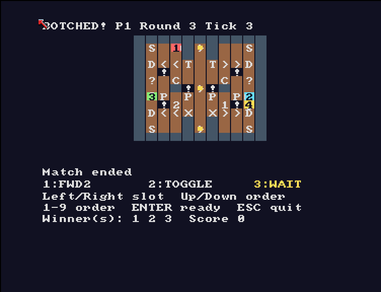

# A1b — keyboard programmes and authoritative replay

A1b adds playable keyboard input and bounded sequential event replay to the
accepted A1a client. It retains the stock 68000, Kickstart 1.3, **512 KB Chip +
512 KB slow expansion RAM** target. A1c's exhaustive multiplayer, disconnect and
timeout acceptance remains outstanding. No subsequent Amiga milestone has begun.

## Playing

Build and launch exactly as in [A1a](a1-review.md):

```text
Stack 16384
BT:botched-amiga tcp://server:7879 existing-match-id
```

The existing wb13 NIO broker must be installed. Only the server operator creates
matches; the guest still only joins the supplied match. The initial programme is
three WAITs. Left/Right or Tab selects a slot; Up/Down cycles its order;
Backspace resets it to WAIT. Number keys directly select:

| Key | Order |
|---|---|
| 1 / 2 / 3 | Forward one / forward two / backward |
| 4 / 5 / 6 | Turn left / turn right / turn around |
| 7 / 8 / 9 | Drop / toggle / wait |

Enter commits all three orders and marks the player ready. Sending and accepted
feedback are distinct; repeated Enter and type-ahead edits are suppressed once
submission is pending. Accepted programmes are locked for that round. The next
planning round resets the editor to three WAITs. Escape quits; R expedites the
next ordinary poll. There is no controller implementation in this slice.

The board displays authoritative events sequentially, with round/tick, acting
player and order feedback, moving robots/crates and changing hazard/group state.
The slot for the current replay tick is highlighted. Scores and winners come
from the server. No engine simulation or prediction runs in the guest. A timed
planning phase displays approximate seconds remaining, computed from the server's
absolute deadline and the Amiga clock. This requires a correctly set guest clock;
it is informational and never decides when to close planning. The server handles
missed deadlines and default WAITs even if the guest is busy replaying.

The existing eight-colour 320x200 display remains intentionally simple. Drawing
is direct to the visible bitmap and can visibly redraw/tear; this is not polished
animation. The Linux SDL client was also run headlessly against a real server and
its layout inspected as a reference; its code is unchanged.

## Ownership, requests and reconciliation

* The existing separate NIO process owns the B4 session, credentials, exchange
  IDs, library buffers and requests. The foreground queues jobs and continues
  processing input while they run. Exec message replies publish completed data.
* SUBMIT uses the authenticated bound session, current round, revision 1,
  three orders, ready=true and the numeric H3 key returned by BOUND. A logical
  submission allocates one key. B4 retains the exact payload and exchange ID
  across its retries; the Amiga never invents a second key to retry a request.
  Revision 1 is sufficient because A1b commits once per round, with no unready
  programme revision feature. Key exhaustion fails explicitly.
* A SUBMIT is **18 body bytes, 21 payload bytes, 23 TCP frame bytes**. The frozen
  P240 maximum remains 242 framed bytes. No wire layout or profile changed.
* EVENTS/FETCH publishes one validated page at a time. The foreground consumes
  one event per replay step before allowing the next page. A queued submission
  cannot interrupt an immutable paged transfer. No growing event queue exists.
* B4 validates stream grammar and page freshness; duplicate pages marked
  apply=false are ignored, including duplicates received during replay. The
  portable model additionally checks destination capacities and coordinates.
* The presentation's acknowledged event watermark advances only when the final
  page is fully consumed, never at its last EVENT before trailing metadata has
  drained. It never regresses. B4's separate validation watermark retains its
  existing monotonic semantics. A snapshot changes the query baseline, not the
  acknowledged event watermark. Empty/eventless transfers still advance their
  version cursor and watermark correctly.
* After a nonempty batch, EVENTS runs again to catch up. Only an empty batch
  leads to a snapshot refresh. If the snapshot is newer than the consumed cursor
  (for example, a deadline races that refresh), it is held offscreen while the
  remaining events are fetched and replayed. Only a caught-up snapshot is
  published. The initial snapshot establishes a baseline without replaying
  pre-join history. Explicit history-expired errors allow a replacement baseline
  without resetting the acknowledged watermark.
* Worker, incoming snapshot and displayed mirror are distinct fixed storage.
  A refreshed snapshot cannot overwrite playback in progress. A queued programme
  from an old round is discarded instead of being submitted in a new round.

Normal network operations do not block the foreground. Shutdown still waits for
existing bounded worker I/O before unloading code. General network/game errors
stop polling with a visible code; automatic interactive reconnect/rebind is not
claimed. History-expired fallback exists, but exhaustive recovery/stall testing
belongs to A1c.

## Verification

`tools/amiga/accept.py` uses the same actual A500/KS1.3 configuration, existing
wb13 broker, serial bridge and NIO NetworkDevice TCP service as A1a. Neither the
NIO API nor server is mocked. It creates matches as the host server operator,
then sends actual raw-key input to the emulator:

1. Foundry-01, three rounds, three server bots: select FWD2/TOGGLE/WAIT each
   round, press Enter twice while pending, observe exactly three accepted
   programmes, replay **90 events**, and reach FINISHED.
2. Factory-01, two rounds, three bots, eight-second planning deadlines: submit
   nothing, replay **57 events** including planning closure and default orders,
   and reach FINISHED.
3. Both guest event-type sequences exactly match the server's ordered event
   streams from their initial snapshot baselines. Final player positions/scores
   for the submitted match match the server. Both exits succeed and available
   memory is identical after the first and second launch.



Screenshot from the preceding passing run (`a500-i1dpasl6`), before the final
empty-page Enter queuing fix. The final run (`a500-nwkefavl`) passed the same
acceptance; its screenshot happened to catch a partial visible redraw. All
measurements and executable hashes below identify the final build.

Native tests reconstruct all nine shipped maps and run three rounds per map:
**27 rounds, 803 events**. Each event's presentation result is compared with the
existing Linux UI model (robots, headings, damage/carrying, crates, scores,
deliveries/sabotage, groups, traps and turrets). Tests exercise actual encoded
SUBMIT bodies, exact exchange retries, H3 retries under a fresh exchange,
deadline defaults, paginated/duplicate pages, delayed acknowledgement, snapshot
baseline reconciliation, eventless versions and keyboard pending-state rules.
Focused codec/NIO tests and Amiga tests pass; Amiga native tests also pass with
ASan/UBSan. This is emulator and native evidence, not physical serial-hardware
acceptance or exhaustive mixed-human multiplayer acceptance.

```sh
source "$NIO_WORKSPACE/scripts/env.sh"
make -f tools/amiga/Makefile
cmake -S . -B build
cmake --build build -j4 --target botched-tcp-server botched_amiga_model_test botched_amiga_gameplay_test
ctest --test-dir build -R 'botched_amiga|botched_wire_c_test|botched_nio_c_test|botched_nio_binding_test' --output-on-failure
python3 tools/amiga/accept.py
```

Licensed media and existing workspace emulator/broker tools are required, as
specified in A1a. Full guest logs, server events, snapshots, screenshots and
machine settings are in ignored `build/amiga/evidence/`; `latest-evidence` points
to the final passing run. Checked-in [measurements](a1b-measurements.json) record
the executable, library and broker hashes. `--capture` enables per-event logging
and snapshot dumps for acceptance; normal play avoids those file writes.

## Complete 1 MB budget

The [A1a measurements](a1a-measurements.json) remain unchanged. All values below
are bytes; the expansion pool is slow RAM, despite Exec calling it MEMF_FAST.

| Measurement | A1a | A1b |
|---|---:|---:|
| Executable file | 46,204 | 54,564 |
| Linked text / DATA / BSS | 37,128 / 304 / 12,048 | 44,324 / 312 / 17,292 |
| Resident hunks including runtime/NIO static buffers | 49,480 | 61,928 |
| Reserved UI / worker stacks | 16,384 / 8,192 | 16,384 / 8,192 |
| Conservative measured UI / worker stack high-water | 1,812 / 1,856 | 1,852 / 1,876 |
| Display bitplanes (Chip) | 24,000 | 24,000 |
| Lowest sampled total free RAM | 752,336 | 739,736 |
| Chip / expansion free at that point | 415,184 / 337,152 | 415,184 / 324,552 |
| Largest Chip / expansion block | 414,944 / 333,720 | 414,944 / 324,040 |
| Broker baseline minus live free RAM | 106,928 | 119,552 |
| Free after first / second exit | 851,288 / 851,288 | 851,312 / 851,312 |

Application hunks + both reserved stacks + bitplanes total **110,504 bytes**,
before dynamic OS/library allocations. Those allocations, boot OS, broker,
Shell and test share are included in the actual free-memory readings. The
first-use retained service/runtime allocation remains 7,976 bytes, with no growth
on the second launch. Values are sampled during real gameplay, not a proof of
every transient allocator peak.

BSS counts all three world mirrors, B4 session/reply storage, worker publication,
foreground notice and replay-page copies, and the existing 2,240-byte linked NIO
library BSS. The one-page replay limit does not mean there is only one physical
copy of those bytes. The extra incoming mirror deliberately buys safe snapshot
publication. There are no application allocations proportional to event history.

Stack probes retain A1a's conservative active-frame guard and CLI bottom exclusion;
these are high-water observations, not reduced safe stack reservations or a proof
of every startup/interrupt path. The full 16 KB + 8 KB reservations stay in place.
There is no true Fast RAM, RTG, accelerated CPU, OS2 API or extra-memory fallback.

## Review boundary

A1b is complete for review. A1c must exercise full mixed-human multiplayer,
stalled/disconnected NIO, retry/rebind/timeouts and shutdown under those faults,
including retained-history recovery and stronger long-run memory checks. It must
retain the same 1 MB profile. No lobby, CREATE_MATCH, server-managed slots, new
artwork, sound, controller support or Atari work was added. Rules, frozen codec,
B4 transport, Linux clients, NIO library and firmware are unchanged.
