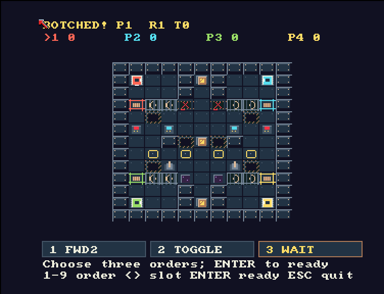
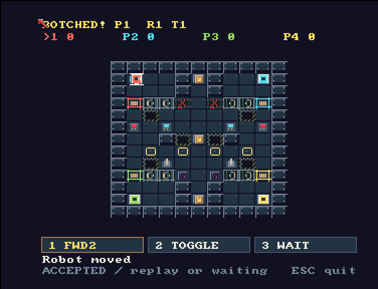

# Amiga A2a — first graphical presentation

A2a keeps the stock PAL A500 / 68000 / Kickstart 1.3 / OCS target with
512 KB Chip and 512 KB slow expansion RAM. No graphics acceleration, sound,
controller, lobby, server, protocol or Atari work is included.

## Presentation and ownership

The screen is now 320×256, four bitplanes, with an original 16-colour industrial
palette and 16×12 pixel tiles. Steel walls have raised edges and bolts; conveyors
have directional chevrons; docks use player colours; dispensers have hoppers;
pits are recessed; consoles, emitters, traps, tar generators, turrets and pads
have separate art. Robot tracks, chassis, facing lights, carried-crate markers and
damage bars replace the diagnostic numbers. The local robot has a white underline.
The header identifies the local player, round and tick; four coloured score fields,
three selected/executing order cards, submission/replay feedback and the inherited
approximate planning countdown retain the A1 keyboard controls.

The Linux SDL client's order queue, player colours and sequential narration informed
this layout. This is deliberately a smaller pixel-art treatment rather than a
copy of its larger-window graphics. All nine maps fit without cropping or scrolling;
the maximum legal 20×16 board occupies 320×192, between the header and order panel.

- `assets.c/h`: original procedural pixel art and palette, expanded once into a
  Chip bitmap atlas and transparency mask. No generated/external image dependency.
- `display.c`: board composition, dirty-cell tracking, masked sprite blits and
  display ownership. Immutable terrain lookups are cached; conveyor direction
  changes invalidate the relevant image lookup. Actual hazard state drives indicators.
- `visual.c/h`: bounded integer interpolation and animation lifetime, separate
  from the authoritative world. No rule simulation or prediction.
- `ui.c`: independently cached header, score, order and feedback strips.
- `main.c`: schedules presentation between existing replay calls and services
  keyboard/worker publication throughout. Network/session/recovery code is unchanged.

One offscreen bitmap receives changed background cells and sprite composition;
only dirty cells are copied to the visible screen. UI strips are copied only when
their content changes. This is not display-flipped double buffering: small updates
can cross a raster scan, but there is no full-screen clear/redraw per event.

## Animation and reconciliation

Each validated event still updates the A1 presentation mirror exactly once. A
separate pre-event mirror supplies interpolation endpoints; it is never written
back into world state. Movement/push/crate movement use eight presentation steps;
turns and interactions use six; structural/narration events use one. Crates briefly
persist visually during pickup/destruction; carried state, turn facing, damage,
respawn and score flashes follow the received outcome. Hazard hits flash the robot;
scoring adds a small gold sparkle. These are deliberately simple first-pass effects:
turns change facing at the midpoint, and there are no projectile paths, elaborate
explosions or polished transfer arcs yet.

The next replay event cannot run until the current presentation completes. A page
cannot drain/advance its acknowledgement while an animation is active. Existing
snapshot reconciliation, immutable page handling, eventless versions and worker
ownership remain in place. Animation does not fetch, submit or acknowledge anything.
The foreground continues reading input; Escape retains A1c's safe worker shutdown.

`--capture` records `EVENT` and matching `ANIM` ordinals, types, presentation steps
and elapsed 20-ms ticks. The capture's RESULT publication follows completed state
and planar file writes, so the harness cannot mistake a partial file for a snapshot.
KS1.3's compact RawDoFmt-backed `sprintf` requires long numeric/string arguments;
the graphical labels use that supported subset.

## Verification

From the repository after sourcing the workspace environment:

```sh
make -f tools/amiga/Makefile
cmake --build build -j4 --target botched_amiga_model_test botched_amiga_gameplay_test botched_amiga_reliability_test
ctest --test-dir build -R botched_amiga --output-on-failure
python3 tools/amiga/accept.py --a2a
```

Native tests retain the nine-map, 27-round, 803-event Linux presentation equivalence
run and now check bounded animation coordinates, exact endpoints, one completion
per event, unchanged authoritative mirrors and no acknowledgement movement during
animation. All three native Amiga suites also pass under ASan/UBSan with leak
detection. These are host tests, not emulated CPU timings.

The extended emulator harness runs two real NIO matches, submits three programmes
through raw keyboard input, matches all replay event types in order against the
server, and checks a matching animation completion for every event. It then launches
the other seven maps for screenshots and clean-exit memory checks. It uses licensed
disposable KS1.3/Workbench media, the existing broker and actual NIO NetworkDevice
TCP service, OCS, cycle-exact 68000, no JIT/Fast/Z3 RAM and immediate blits disabled.
No physical hardware testing is claimed.

## Resource and performance evidence

The final run is `build/amiga/evidence/a500-9dd2ksa3`. The
[measurement record](a2a-measurements.json) includes executable/library/broker
hashes, settings and all nine launches. Two matches completed **142 events**
(86 + 56), each with exactly one completed animation. Three keyboard programmes
were accepted once; the second match completed by deadlines. All nine exits
returned **851,312 bytes** free, with no accumulating per-launch loss observed.
The seven extra map launches test initial rendering, not complete games on those maps.

| Bytes | A1c | A2a |
|---|---:|---:|
| Executable file | 55,568 | 62,036 |
| Text / DATA / BSS | 45,324 / 312 / 17,364 | 51,056 / 296 / 25,516 |
| Resident hunks | 63,000 | 76,868 |
| Visible/offscreen bitplanes | 24,000 | 81,920 |
| Atlas + mask | — | 5,160 |
| Reserved foreground / worker stacks | 16,384 / 8,192 | 16,384 / 8,192 |
| Maximum sampled stack use | 1,856 / 1,940 | 1,932 / 1,940 |
| Lowest sampled Chip / slow RAM free | 415,184 / 323,536 | 352,064 / 309,648 |
| Lowest sampled total free | 738,720 | 661,712 |
| Explicit hunks + stacks + graphics | 111,576 | 188,524 |
| Live cost against broker-loaded baseline | 120,568 | 197,576 |

The two gameplay runs respectively made 392/250 draw calls and copied 519/504
dirty board cells, with **one full board build per launch**. Mean measured draw-call
elapsed times were **52.5 / 57.36 ms**, and maxima **860 / 900 ms**, including initial
board construction. Eight-step robot movement took **600–660 ms**, median
640/620 ms by match. This is a modest animation rate, not 50 fps: library drawing,
sprite composition and capture logging still cost time on the 68000. Keyboard input
is serviced between steps, and networking stays in the existing worker. Further
speed/art polish is a review choice for a later milestone, not an unmeasured claim.

Largest shipped-map capture here is Factory (14×11). The 20×16 protocol maximum
fits the layout by construction; it is not a measured worst-case synthetic graphics
benchmark. Real hardware, NTSC display sizing and exhaustive visual inspection of
every event/effect combination remain unverified. Native nine-map replay coverage
supplements the two emulator gameplay scenarios.

Reproduce the committed evidence publication (Pillow required):

```sh
python3 tools/amiga/visual_report.py build/amiga/evidence/a500-9dd2ksa3
```

Timing uses
KS1.3 DateStamp at 20-ms resolution, includes scheduling/preemption, and is not a
cycle-level profiler. Captured animation elapsed times include per-event DOS logging;
they must not be presented as an uninstrumented frame-rate benchmark.

The display allocates 81,920 Chip bytes for visible/offscreen bitplanes and 5,160
Chip bytes for the 43-image atlas plus mask. The 16,384-byte foreground and 8,192-byte
worker stack reservations are unchanged. Static resident BSS includes the extra
pre-event mirror, dirty signatures, tile cache and UI strings. Guest available-memory
readings additionally account for OS/window/library/broker allocations. No resource
budget relies on the development machine's extra memory.

A2b remains unstarted. The next review can choose animation polish, more elaborate
art or further rendering optimisation; none is assumed by this commit.

## Screenshots

These are unretouched Amiberry screenshots from the final executable. The mouse
pointer is the stock Workbench pointer. The GIF assembles eight actual movement
captures at 50 ms per image; screenshot IPC time makes it a visual sample, not a
frame-rate measurement.





All maps (open links for full-size captures):

| Map | Capture |
|---|---|
| Foundry | [Orders and board](a2a/orders-1.png) |
| Factory | [Completed deadline match](a2a/display-second.png) |
| Training | [Board](a2a/map-training-01.png) |
| Laserworks | [Board](a2a/map-laserworks-01.png) |
| Trapworks | [Board](a2a/map-trapworks-01.png) |
| Turretworks | [Board](a2a/map-turretworks-01.png) |
| Tarworks | [Board](a2a/map-tarworks-01.png) |
| Shuntworks | [Board](a2a/map-shuntworks-01.png) |
| Crossroads | [Board](a2a/map-crossroads-01.png) |
