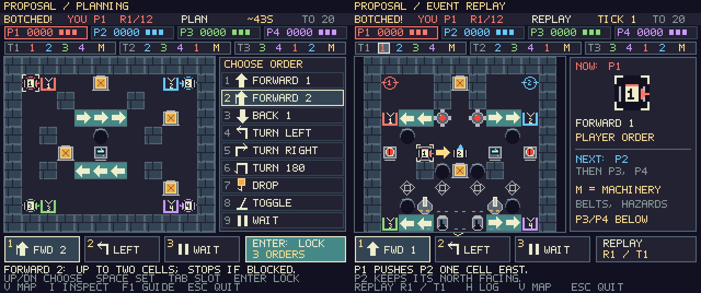

# A2b proposal — make each decision and outcome readable

**Design for review, not an implemented client.** The PNGs are exact 320×256 pixel
mockups using one 16-colour, 12-bit OCS palette. Enlargements use nearest-neighbour
scaling. Geometry comes from all nine shipped maps; robot positions, programmes,
clock and scores illustrate UI states, not recorded server events. The push panels
are consecutive illustrations; the trap panel is a separate scenario.

## Recommended screen

| Pixels | Purpose |
|---|---|
| y 0–10 | You, round/cap, PLAN or REPLAY, approximate deadline or replay tick, target if enabled |
| y 12–23 | Four numbered, colour-coded scores and three remaining-durability pips; your seat outlined |
| y 26–37 | All three ticks: ordered player numbers followed by **M** (machinery) |
| x 4–195, y 40–199 | 192×160 board viewport, **16×16 tiles**, 12×10 cells |
| x 200–315, y 40–199 | Planning: all nine labelled commands. Replay: actor, order, next player and machinery context |
| y 204–227 | Three programme slots and explicit ENTER: LOCK / SENDING / ACCEPTED / REPLAY state |
| y 231–253 | Command explanation or two-line outcome narration, with context-sensitive controls |

No title banner, decorative panel or scrolling message log competes with the board.
The 5×7 lettering has a six-pixel advance and eight-pixel line spacing; labels and
icons are drawn without antialiasing. Native-size and CRT legibility still require
human review; a sharp enlarged PNG alone is not evidence of that.

**Trade-off requiring approval: larger pieces, with camera movement.** Seven maps
are 12×10 and fit in full. Factory is 14×11; Foundry is 11×13. These two pan at tile
boundaries, without shrinking the artwork. The legal 20×16 maximum also uses the
same viewport. In planning, centre on your robot; `I` enters tile inspection, arrows
move its cursor and pan at the edge. During replay, centre on the event's subjects
before presenting it and hold the camera through that action. If a push chain spans
the viewport, temporarily use overview and retain numbered subject markers.
Offscreen-player indicators and camera-edge arrows must remain outside terrain.

`V` switches to a complete, schematic **8×8-cell overview**, with a white viewport
rectangle. This is for orientation, not identifying machinery. `I` selects a tile;
returning to detail centres that tile. Help/inspection must not stop network service
or the server clock. No continuously allocated full-map bitmap is needed.

[Planning](a2b/01-planning-3x.png) · [Foundry crop](a2b/02-foundry-3x.png) ·
[Overview and round-two priority](a2b/03-overview-3x.png) ·
[All nine overview layouts](a2b/all-nine-overviews.png)

## Visual language and command entry

Robots have tracks, a bright numbered body and an external facing nose; the local
robot has corner framing. Cargo is a small gold pack, leaving number and facing
visible. Coral/cyan/green/violet identify P1–P4 consistently on robots, docks, scores
and priority. Colour is redundant with numbers; **gold belongs to neutral crates**.
Walls are subdued, floors quiet. Crates have crossed wooden slats; dispensers have
a metal mouth that remains visible around a crate. Docks are an open delivery tray,
spawns a numbered crosshair. Conveyors have large directional arrows, not fine
texture. Hazard silhouettes are distinct: toothed burst trap, barrel laser, rotating
turret and tar drum. Tarred floor uses sparse oil marks, not another player colour.

[Field guide](a2b/07-field-guide-3x.png) shows the vocabulary. Inspection supplies
what cannot fit on a tile: group/console links, ownership, trap armed/off, turret
charge 0/2–READY, carried crate, coordinates and tile effects. Selecting a console
highlights its affected group; selecting a hazard shows its fixed footprint, **not
predicted victims**. Owned machinery gets an owner-number badge; neutral reads NONE.
Armed/ready and idle states also differ in shape/pips, not colour alone. The shown
trap flash is transient; its disarmed resting sprite loses the lit centre.

The palette always displays `FORWARD 1`, `FORWARD 2`, `BACK 1`, `TURN LEFT`,
`TURN RIGHT`, `TURN 180`, `DROP`, `TOGGLE`, `WAIT`, each with icon and existing 1–9
shortcut. **Up/down browses; Space sets the highlighted slot; Tab or left/right
changes slot; Enter locks.** This deliberately replaces up/down's immediate cycling
with browsing plus placement. Numbers and Backspace-to-WAIT remain. No memorisation
or mouse is required. Slot focus and command focus have different borders.
Fixed-width counters must handle round/cap 200 and target 1000; oversized scores
use an explicit compact suffix, with the exact value in inspection.
The footer explains the highlighted command, including automatic pickup/delivery,
DROP not scoring, nearby TOGGLE controls, tar restrictions and WAIT still riding belts.

Enter immediately shows **SENDING**, disables editing, and retains the exact
submitted three orders. Only an affirmative response changes it to **ACCEPTED:
waiting for players**. Rejection, expired round and uncertain connection remain
explicit, never green success. The existing retry/lock/reconciliation behaviour
is retained. Deadline display is approximate (`~43S`), with NONE for untimed games;
help does not pause it. Match completion replaces the action panel with winners,
final scores and reason, only after the authoritative end event/snapshot.

## Explain execution, not just motion

The priority strip previews *seats*, never opponents' hidden programmes. For tick
`t` of round `r`, start at `(((r-1)*3+t-1) % player_count)+1` and wrap. Thus four-player
round one is `1234 / 2341 / 3412`; round two is `4123 / 1234 / 2341`.
During replay, ORDER events select the active numbered chip; completed entries get
a tick, skipped disabled orders a slash. **M** highlights belts/lasers/traps/turrets,
not another player's turn. The sidebar names the current phase and source.
Use actual event sequencing/cause fields; snapshot catch-up must say **State refreshed**
rather than fabricate actions. Show replay round/tick separately from any newer
planning deadline; never imply the server waits for playback.

[Push: before](a2b/04-push-before-3x.png) →
[displacement](a2b/05-push-displacement-3x.png) →
[result](a2b/06-push-result-3x.png) · [Trap example](a2b/08-machinery-3x.png)

Every visible action gets **actor → action → result** text tied to the same event
as its visual effect. A push names both robots and preserves the pushed robot's
heading; F2 shows its separate substeps. Turns show old/new facing. Belt movement
says BELT, blocked movement marks the obstruction, pickup/drop names cargo, and
delivery shows the authoritative +5. A trap/turret identifies source, victim and
remaining durability. SHUNT and sabotage amounts appear only from score events;
never infer a scorer from nearby colours. Current engine durability is **three**
(`kMaxHealth`), regardless of the SDL panel's older two-pip artwork.

Keep a bounded 16-entry caption history (`H`), not a second replay/event store.
Aim for a short source highlight, clear movement/result, then a readable caption
hold. Exact pacing is deferred to A500 measurement; no new grouping may reorder,
skip, acknowledge early or double-apply events. Long chains may span immutable
pages: presentation context can persist, but borrowed event pointers cannot.

## Compatibility, evidence and approval gate

Use the existing screen/back bitmap and dirty rectangles. The four-plane pair
remains **81,920 Chip bytes**. Proposed atlas/masks ceiling: 16 KiB; font ≤2 KiB;
caption history and small UI/camera state ≤8 KiB. Cap total incremental residency
(code included) at **48 KiB**, of which ≤24 KiB Chip. These are design ceilings,
not new measurements. The last measured minimum-machine run had 661,224 bytes free
(352,064 Chip); those ceilings leave about 598 KiB total / 320 KiB Chip. Existing
world mirrors, NIO storage and 16/8 KiB process stacks remain accounted for in that
baseline, not counted again. No extra full-screen buffer, RTG, hardware scaling,
new protocol field or additional machine memory is proposed.

References: a fresh [Linux SDL capture](a2b/sdl-reference.png),
`apps/sdl_ui.cpp` / `apps/ui_playback.cpp`, current `src/engine.cpp`,
`include/botched/types.hpp`, binary-v1 event layouts, and shipped map resources.
The SDL command palette, preview queue and narration inform the design; its layout
and incidental artwork are not copied. Headless capture used an isolated server
on 17878, `SDL_VIDEODRIVER=dummy`, `--ui --create --map-id foundry-01 --players 4
--bots 3 --rounds 3 --frames 60 --screenshot /tmp/botched-a2b-sdl.bmp`.

Validation run: `python docs/amiga/a2b/render_mockups.py` checks dimensions,
text extents, ≤16 colours, OCS RGB precision and all nine map geometries.
No game source changed; **no redesigned Amiga executable or emulator performance
result is claimed**. The proposed renderer has not been run on KS1.3.

Approve the layout, scrolling/overview trade-off, sprite vocabulary and keyboard
flow before implementation. Afterwards the first reviewable slice should be the
static board/palette/priority display, then event explanations. Acceptance must
include native-size human review, all nine maps, 2/3/4-player tick rotation,
hazard/cargo recognition, submission uncertainty and replay-prefix equivalence,
plus measured A500 frame cost, Chip allocation and stacks. No A2b implementation,
sound, lobby or further milestone is included in this proposal.
